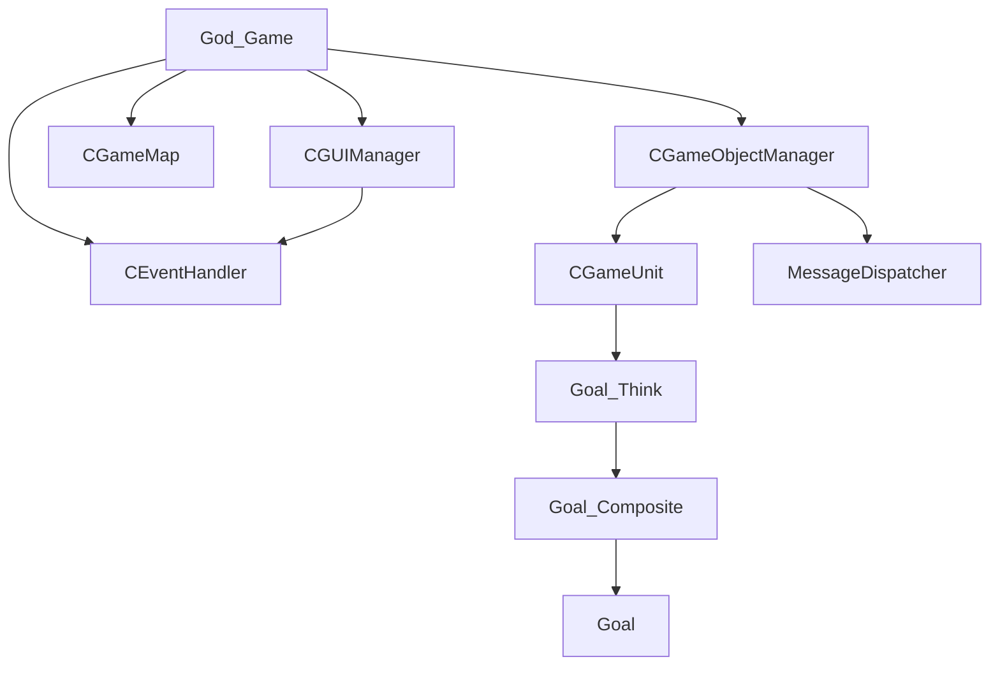

# Demi God — C++ 클라이언트 포트폴리오

2011년에 작성한 게임 클라이언트 코드의 일부를 포트폴리오용으로 정리한 프로젝트입니다. 기존 구조를 유지하면서 C++17 기준으로 명명, 소유권, 인터페이스, 헤더 의존성과 테스트 가능성을 개선했습니다.

> 현재 저장소는 그래픽 엔진, 리소스, 서버 및 일부 플랫폼 의존 기능이 제거된 소스 코드 중심의 샘플입니다. 실행 가능한 완성 게임이 아니며, 일부 메서드와 수학 연산은 스텁 상태입니다.

## 기술 및 구조

- C++, Visual Studio, Win32
- Goal 기반 계층형 AI, 게임 오브젝트 관리, 메시지 전달
- 맵 및 유닛 행동 제어, GUI 이벤트 처리, DLL 플러그인 인터페이스

| 디렉터리 | 역할 |
| --- | --- |
| game/ai | 목표 합성 및 상태 전환, 메시지 객체와 전달기 |
| game/objects | 게임 유닛, 건물, 오브젝트 등록과 제어 |
| game/map | 타일 좌표 및 맵 관리 |
| game/interfaces | GUI 계층 및 입력 처리 연결 |
| game/attributes | 유닛 속성 및 자원 관리 |
| game/PlugIn | DLL 로딩과 외부 인터페이스 |

## 빌드 및 검증

- Visual Studio에서 `demi_god.vcxproj`를 열고 C++ 데스크톱 개발 워크로드와 Windows SDK를 설치합니다. 프로젝트의 도구 집합은 v145로 설정되어 있습니다. 해당 도구 집합이 있는 환경에서 Debug 또는 Release 구성을 선택하여 빌드합니다.
- 현재 검증은 GCC C++17과 로컬 Windows API 검사 전용 대체 헤더로 61개 소스의 컴파일과 링크를 확인한 것입니다. 대체 헤더는 저장소에 포함되지 않으며 Windows 네이티브 빌드나 게임 실행을 보증하지 않습니다.
- 독립 테스트는 렌더링 엔진과 Windows SDK 없이 실행하도록 구성합니다.

## 외부 참고 코드 및 출처

- **Mat Buckland** — AI 프로그래밍 예제 코드. `game/ai/Goal_UnitHuntTarget.h`에 남아 있는 원본 저작자 표기(`Goal_HuntTarget.h`, `www.ai-junkie.com`)를 보존했습니다.
- `game/ai/Goal.h`, `game/ai/Goal_Composite.h`, `game/ai/MessageDispatcher.*`, `game/ai/Telegram.h` 등 관련 AI 및 메시지 전달 코드에도 외부 예제 코드가 포함되어 있을 가능성이 있습니다. 원본과의 대조 및 정확한 참고·수정 범위 확인이 필요합니다.
- 이 저장소는 프로젝트에 적용된 코드를 보여주기 위한 포트폴리오이며, 외부 예제 코드까지 모두 직접 작성했다고 주장하지 않습니다.
- 외부 코드의 원본 라이선스 및 재배포 허용 범위는 아직 확인되지 않았습니다. 공개 또는 배포 전 확인이 필요합니다.
