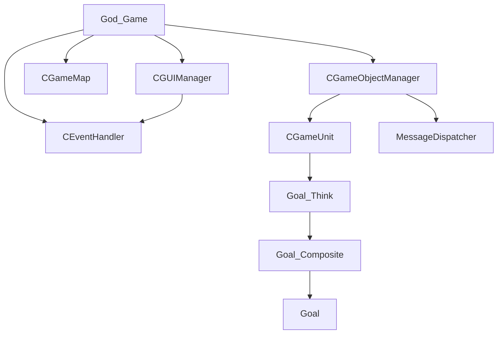
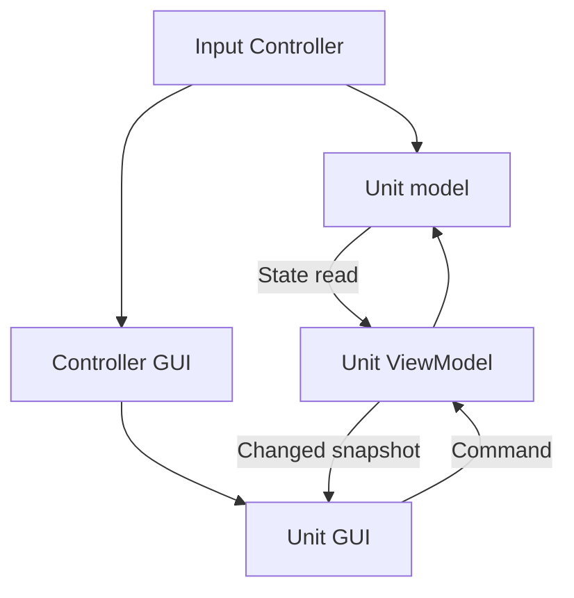
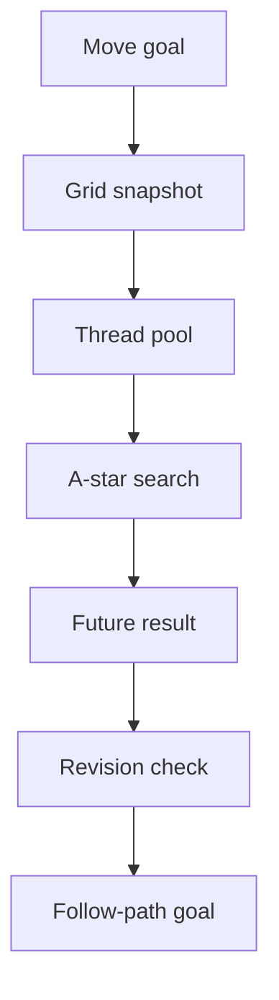

# Demi God — 레거시 C++ 게임 클라이언트 리팩터링

2011년에 작성한 게임 클라이언트 코드의 일부를 C++17 기반 포트폴리오로 정리했습니다. 핵심 개선은 객체 소유권과 삭제 처리, UI와 모델 분리, 맵 변경에 대응하는 비동기 A* 경로 탐색입니다.

그래픽 엔진과 게임 리소스, 서버를 제외한 소스 중심 샘플입니다. 콘솔 데모는 초기화와 프레임 루프를 실행합니다. 경로 탐색 통합 테스트는 경유점 처리와 재탐색을 검증하며 실제 유닛 이동 갱신은 구현 범위 밖입니다.

| 살펴볼 부분 | 코드와 검증 |
| --- | --- |
| 객체 수명 관리 | [객체 관리자](game/objects/CGameObjectManager.cpp) · [등록·삭제 및 참조 무효화 테스트](tests/object_lifecycle_tests.cpp) |
| UI와 모델 분리 | [유닛 ViewModel](game/interfaces/viewmodel/UnitViewModel.h) · [선택·상태·명령 전달 테스트](tests/unit_viewmodel_tests.cpp) |
| 비동기 A* | [이동 Goal](game/ai/Goal_MoveToPosition.cpp) · [맵 스냅샷과 재탐색 테스트](tests/async_path_tests.cpp) |

## 빌드 및 검증

Windows에서 MSVC v145와 Windows SDK를 사용한 Debug x64 빌드, 콘솔 데모 정상 종료, 수학·좌표 테스트를 확인했습니다. MSVC의 소스 인코딩 경고 `C4819`는 남아 있습니다.

Visual Studio의 **x64 Native Tools Command Prompt**에서 저장소 루트로 이동해 실행합니다.

```bat
msbuild demi_god.vcxproj /t:Build /p:Configuration=Debug /p:Platform=x64 /p:IntDir=artifacts\obj\ /p:OutDir=artifacts\demo\
artifacts\demo\demi_god.exe
echo %ERRORLEVEL%
```

데모는 약 1초 동안 최대 60프레임을 실행합니다. 정상 종료 시 콘솔 출력 없이 종료 코드 `0`을 반환합니다.

### 대표 독립 테스트

같은 프롬프트에서 Goal·메시지 데이터, 스레드 풀, A*를 각각 검증합니다.

```bat
if not exist artifacts mkdir artifacts
cl /nologo /EHsc /std:c++17 /utf-8 /I. /Fo:artifacts\core_tests.obj /Fe:artifacts\core_tests.exe tests\core_tests.cpp
artifacts\core_tests.exe
cl /nologo /EHsc /std:c++17 /utf-8 /Fo:artifacts\thread_pool_tests.obj /Fe:artifacts\thread_pool_tests.exe tests\thread_pool_tests.cpp
artifacts\thread_pool_tests.exe
cl /nologo /EHsc /std:c++17 /utf-8 /Fo:artifacts\astar_tests.obj /Fe:artifacts\astar_tests.exe tests\astar_tests.cpp
artifacts\astar_tests.exe
```

예상 출력

```text
3 core tests passed
Thread pool tests passed
A* tests passed
```

### Doxygen API 문서

[Doxyfile](Doxyfile)은 소스 주석에서 클래스와 함수의 HTML 문서를 생성합니다. Doxygen을 설치한 뒤 저장소 루트에서 PowerShell로 실행합니다.

```powershell
New-Item -ItemType Directory -Force .\build\doxygen | Out-Null
doxygen .\Doxyfile
Invoke-Item .\build\doxygen\html\index.html
```

클래스 관계 그래프를 생성하려면 Graphviz의 `dot`이 PATH에 있어야 합니다. Graphviz 없이 HTML 문서를 생성하려면 `Doxyfile`에서 `HAVE_DOT = NO`로 설정합니다.

VS Code에서는 [Doxygen Runner](https://marketplace.visualstudio.com/items?itemName=betwo.vscode-doxygen-runner)를 설치한 후 `Doxyfile`을 열고, 명령 팔레트에서 **Generate Doxygen documentation**, **View Doxygen documentation**을 차례로 실행합니다. 확장이 Doxygen을 찾지 못하면 `doxygen_runner.doxygen_command`에 `doxygen.exe`의 전체 경로를 지정합니다.

생성된 문서는 `build/doxygen/`에 저장되며 Git 추적에서 제외됩니다.

## 개발 이력 및 범위

| 시기 | 내용 |
| --- | --- |
| 2011년 | Demi God 게임 클라이언트 개발. 유닛·건물 관리, Goal 기반 AI, 맵 및 GUI 제어 구조 작성 |
| 2026년 11월 | 기존 소스의 포트폴리오용 정리 및 C++17 기반 리팩토링. 메모리 관리, MVC/MVVM, 메시지 전달, 수학 연산, 스레드 풀 및 비동기 A* 경로 탐색 개선 |

2026년 리팩터링에서는 AI 도구를 코드 리뷰, 수정안 작성, 빌드 오류 진단에 활용했습니다. 기존 코드와 외부 참고 코드의 출처 표기를 보존했으며, 주요 변경과 검증 범위는 커밋 이력과 테스트에서 확인할 수 있습니다.

## 핵심 개선 요약

| 기술 영역 | 개선 내용 |
| --- | --- |
| 객체 생명주기 | `unique_ptr` 기반 소유권, 중복 ID 검사, 지연 삭제 및 참조 무효화 |
| 현대 C++ | RAII, `override`, `nullptr`, `enum class`, const 정확성 및 헤더 의존성 개선 |
| 시스템 설계 | 의존성 주입, 관리자별 메시지 전달기, 즉시·지연 메시지 및 브로드캐스트 |
| UI 아키텍처 | MVC 기반 선택 제어, MVVM 기반 유닛·건물·메인 UI 상태 및 명령 분리 |
| 수학 및 알고리즘 | 벡터·좌표 연산, 타일 기반 A* 최단 경로 탐색 |
| 동시성 | 스레드 풀, mutex, condition_variable, future 기반 비동기 경로 요청 |
| 검증 | 객체 생명주기, 메시지 전달, 좌표 연산, MVVM 및 경로 탐색 단위·통합 테스트 |

## 기술 및 구조

- C++, Visual Studio, Win32
- Goal 기반 계층형 AI, 게임 오브젝트 관리, 메시지 전달
- 맵 및 유닛 행동 제어, GUI 이벤트 처리, DLL 플러그인 인터페이스



| 디렉터리 | 역할 |
| --- | --- |
| game/ai | 목표 합성 및 상태 전환, 메시지 객체와 전달기 |
| game/objects | 게임 유닛, 건물, 오브젝트 등록과 제어 |
| game/map | 타일 좌표 및 맵 관리 |
| game/interfaces | GUI 계층 및 입력 처리 연결 |
| game/attributes | 유닛 속성 및 자원 관리 |
| game/PlugIn | DLL 로딩과 외부 인터페이스 |

## UI 아키텍처 (MVC + MVVM)

유닛·건물·메인 게임 UI는 MVC의 선택/입력 제어와 MVVM의 표시 상태/명령으로 구분했습니다.

- Model: CGameUnit / CGameUnitAttribute / CGameRoom / CGameResourceManager
- Controller: CObjectController / CGameObjectManager (선택과 입력 처리, ISelectionView 경계)
- ViewModel: UnitViewModel (유닛 HP·레벨·명령), RoomViewModel (건물 HP·삭제 명령), MainGameViewModel (자원·경험치·레벨·선택 상태)
- View: CUnitGUI, CRoomGUI, CMainGameGUI 및 각 유닛·건물별 UI



ViewModel은 메인 스레드의 프레임 갱신 시 변경된 값만 알립니다. 객체 수명 토큰을 통해 삭제된 유닛에 대한 참조를 무효화하며 모델을 공동 소유하지 않습니다. 엔진 렌더러가 없는 상태에서도 표시 데이터 및 명령 전달을 테스트할 수 있습니다. 건물 UI와 메인 게임 UI도 동일한 스냅샷 방식으로 갱신합니다. 건물의 사운드 요청은 GUI를 경유하지 않고 composition root의 사운드 처리 경계로 전달합니다. Model 소스는 구체 GUI 클래스를 참조하지 않습니다. 엔진 의존 오브젝트 생성·피킹·실제 렌더링 및 일부 기존 기능은 여전히 스텁입니다.

## 비동기 타일 경로 탐색

- `ThreadPool`: 고정 작업 스레드, mutex, condition_variable, future, 종료 시 대기 작업 완료 및 join.
- `NavigationGrid` / `AStar`: 4방향 타일 이동, Manhattan 휴리스틱, 장애물 우회와 최단 경로 복원.
- `AsyncPathfinder`: 맵 스냅샷과 revision을 값으로 전달하고 결과를 future로 반환.
- `Goal_MoveToPosition`: 메인 스레드에서 non-blocking polling, 오래된 revision 재탐색, `Goal_FollowPath` 경유점 연결.



작업 스레드는 유닛·GUI·실시간 맵 객체에 접근하지 않습니다. 경로 요청 및 결과 적용은 메인 스레드에서 이루어집니다. 실제 엔진의 이동/충돌/렌더링은 제거된 상태이므로 통합 테스트는 좌표를 직접 변경하여 경유점 순서와 완료 상태를 검증합니다. 기본 워커 수는 2개이며, 작업 큐는 아직 별도의 용량 제한이나 우선순위를 두지 않습니다.

## 외부 참고 코드 및 출처

- **Mat Buckland** — AI 프로그래밍 예제 코드. `game/ai/Goal_UnitHuntTarget.h`에 남아 있는 원본 저작자 표기(`Goal_HuntTarget.h`, `www.ai-junkie.com`)를 보존했습니다.
- `game/ai/Goal.h`, `game/ai/Goal_Composite.h`, `game/ai/MessageDispatcher.*`, `game/ai/Telegram.h` 등 관련 AI 및 메시지 전달 코드에도 외부 예제 코드가 포함되어 있을 가능성이 있습니다. 원본과의 대조 및 정확한 참고·수정 범위 확인이 필요합니다.
- 이 저장소는 프로젝트에 적용된 코드를 보여주기 위한 포트폴리오이며, 외부 예제 코드까지 모두 직접 작성했다고 주장하지 않습니다.
- 외부 코드의 원본 라이선스 및 재배포 허용 범위는 아직 확인되지 않았습니다. 공개 또는 배포 전 확인이 필요합니다.
